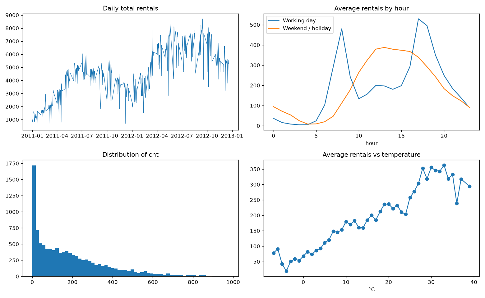
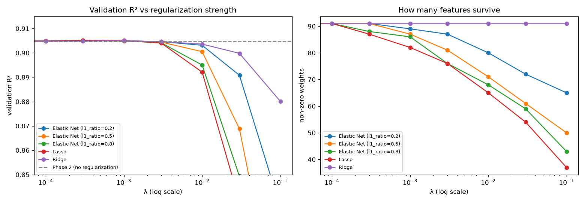

# Rush Hour: Predicting Bike-Sharing Demand

A five-phase machine learning pipeline that predicts hourly bike rentals for a city bike-sharing system and flags unusually busy hours. Every model is trained with **gradient descent implemented from scratch in NumPy**: linear regression, polynomial regression, Ridge, Lasso, Elastic Net and logistic regression.

Built as a team project for the Machine Learning course (Winter 2026) at the German International University of Applied Sciences.

## The problem

A bike-sharing operator must decide every hour how many bikes to place at its stations. Too few, and customers find empty docks; too many, and trucks move idle bikes around for nothing. The question behind every decision is: **how many bikes will be rented in this hour?**

The data covers two years of hourly records (Capital Bikeshare, Washington D.C., 2011–2012): calendar, weather and the number of rentals (`cnt`).

## Results at a glance

| Stage | Validation result |
|---|---|
| Linear model (gradient descent from scratch) | R² 0.871, RMSE 64.4 bikes |
| + polynomial weather features (degree 3) | R² 0.905, RMSE 55.3 bikes |
| + Lasso and removal of 4 redundant columns | **R² 0.912, RMSE 53.2 bikes** |
| High-demand classifier (logistic regression) | ROC-AUC 0.851, F1 0.638 |
| Cost-aware model (under-prediction costs 3×) | operator cost −11% |

## The pipeline

Each phase consumes the output of the previous one.

1. **Gradient descent.** A linear model on 75 engineered features: one-hot hours, an hour × working-day interaction (working days have two commuter peaks, weekends one midday hump), and a log(1 + cnt) target. The learning rate was chosen from a sweep and matches the theoretical stability limit (0.273); results were verified against the exact least-squares solution.
2. **Polynomial regression.** Degree-3 terms for temperature, humidity and wind speed, initialized from Phase 1's weights.
3. **Bias–variance analysis.** Learning curves show no overfitting. A chronological split revealed that R² hid a 22% rise in RMSE and a systematic over-prediction when extrapolating growth into a later period.
4. **Regularization.** Ridge, Lasso (proximal gradient descent) and Elastic Net, compared fairly. Drop-column tests gave an evidence-based verdict for every input column; removing four redundant columns improved accuracy.
5. **Logistic regression.** "High demand" is defined relative to each time slot (year × hour × day type), after showing that a single global threshold only teaches the model to read the clock (hour-only AUC 0.906).

**Bonus:** an asymmetric loss where under-predicting demand costs 3× more than over-predicting, with its gradient derived and implemented by hand.

## Key findings

- **The random split is optimistic.** Hours from the same day land in both training and validation. A split that holds out whole days (matching the real test set) lowers R² from 0.905 to 0.891.
- **R² can hide error.** On a chronological split R² barely moved (0.905 → 0.904), but RMSE rose from 55 to 68 bikes, because the later period is more variable.
- **Redundancy needs pairs to prove.** Dropping `season` alone changes nothing, but dropping `season` and `mnth` together costs 0.020 R².
- **Choose metrics for the class balance.** A model that never predicts "high" already scores 74% accuracy, so the classifier is judged on ROC-AUC and F1, with the cut-off tuned on training data.





## Repository contents

| Path | What it is |
|---|---|
| `pipeline.ipynb` | The full pipeline, with expectation and outcome notes for every phase |
| `Bike_Demand_Report.pdf` | 5-page report explaining every modeling choice with the pipeline's numbers |
| `figures/` | All charts produced by the notebook |
| `sample_submission.csv` | Predictions for the held-out test hours |
| `requirements.txt` | Python dependencies |

## How to run

```bash
pip install -r requirements.txt
```

Put `train.csv`, `test.csv` and `sample_submission.csv` in a `data/` folder next to the notebook, then run all cells. The data is the public [UCI Bike Sharing dataset](https://archive.ics.uci.edu/dataset/275/bike+sharing+dataset), as split by the course.

## Tech

Python, NumPy, pandas, Matplotlib. scikit-learn is used only for the train/validation split and for evaluation metrics, never for fitting models.
